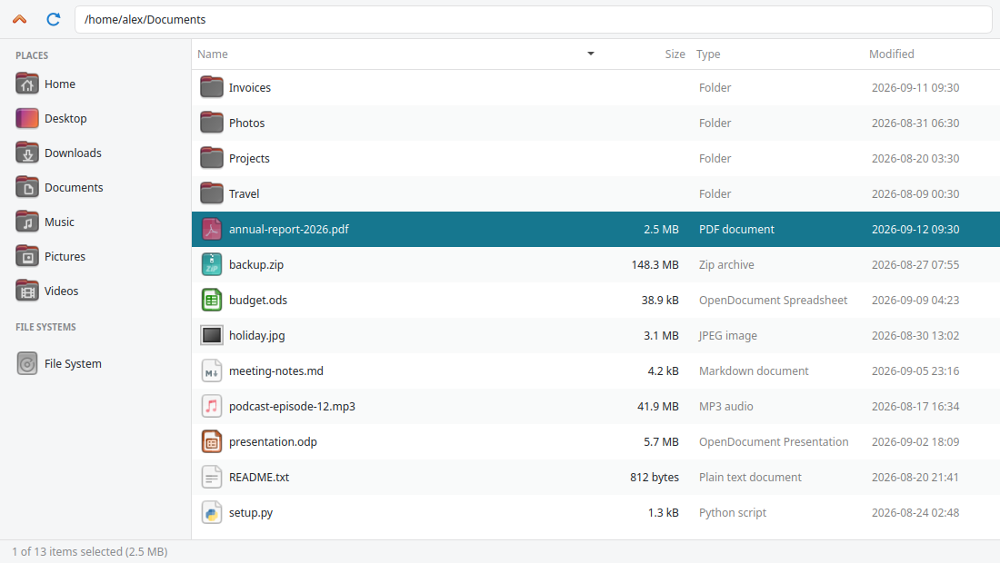

[](https://badge.fury.io/py/flitz)
[](https://pypi.org/project/flitz/)
[](https://flitz.readthedocs.io/en/latest/)
[](https://github.com/MartinThoma/flitz)

# flitz


A file explorer / finder with a Qt (PySide6) GUI. Fast Location / Indexing / Traversal Zone.



## Installation

```
pip install flitz
```

## Usage

Start it by executing `flitz` or `python -m flitz`.
It might also be `python3 -m flitz` on your machine.

## Development

flitz uses [uv](https://docs.astral.sh/uv/) to manage its dependencies:

```bash
uv sync               # create .venv with all development dependencies
uv run flitz          # start flitz
make test             # run the tests
make lint             # ruff + mypy
pre-commit install    # run the checks before every commit
```

## Releasing

1. Update `flitz/_version.py` and `CHANGELOG.md` in a `REL: x.y.z` commit.
2. Create a tag with the release notes as tag message body: `git tag -s x.y.z`
3. Push the tag: `git push origin x.y.z`

The [release workflow](.github/workflows/release.yaml) publishes the package
to PyPI and creates a GitHub release.
